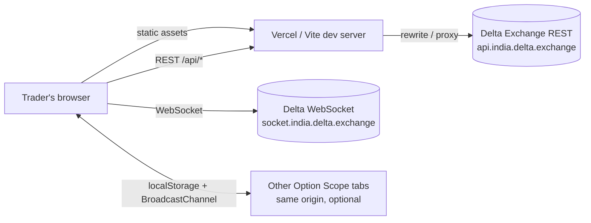
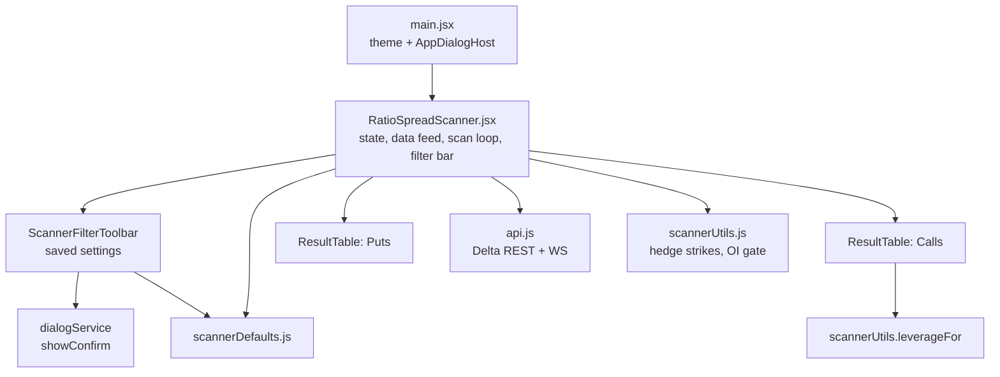
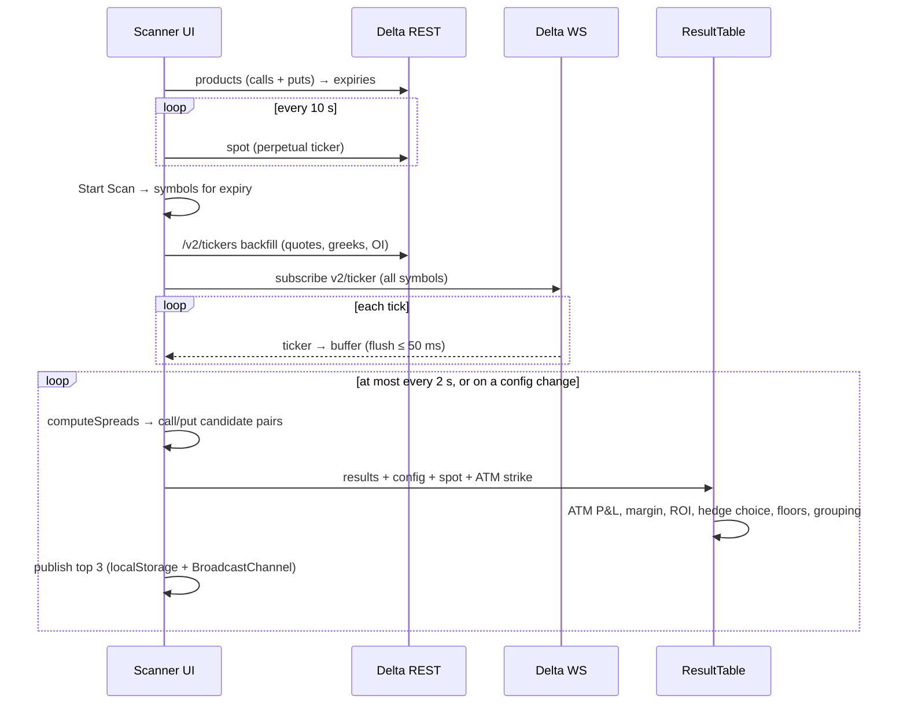

# Ratio Spread Scanner: High-Level Design

## 1. Purpose

The scanner finds option ratio spreads (buy 1 option, sell N further-OTM options of the same type and expiry) on Delta Exchange India for BTC and ETH. It shows live data and ranks each spread by its projected edge if spot moves to the long strike.

This is a standalone, client-only copy of Option Scope's Ratio Spread tab. Its numbers (sizing, leverage, hedge choice, OI gate) match the Option Scope paper and live engines, so what the scanner shows is what those engines would act on.

## 2. Scope

**In scope**

- Live discovery and display of call and put ratio spreads for a chosen underlying and expiry
- Configurable entry filters, ATM ratio scaling, and ATM P&L and ROI floors
- An optional hedge leg (3rd long)
- An optional filter for Delta's open-interest (OI) limit
- Saved filter settings, kept per browser

**Out of scope**

- Order placement, positions, and paper or live trading (these live in Option Scope)
- User accounts, a server, or a database

## 3. System context

- **REST** (`/v2/products`, `/v2/tickers`) goes through `/api` to avoid CORS. Vercel uses a rewrite and Vite dev uses a proxy.
- The **WebSocket** connects directly to Delta's public `v2/ticker` channel.
- No data leaves the browser apart from these read-only market-data calls.

## 4. Architecture

It is a single-page React app with one page and no router.

| Component | Responsibility |
| --- | --- |
| `main.jsx` | Mounts the app, owns the light/dark theme, and renders the in-app dialog host |
| `RatioSpreadScanner.jsx` | Loads products and expiries, polls spot, runs the REST backfill and WebSocket stream, buffers ticks, runs `computeSpreads` (pairing and entry filters), persists config, and publishes the top spreads |
| `ResultTable.jsx` | Per row: ATM pricing, the $195k cap and leverage, hedge pricing and choice, margin, ROI, and the ATM floors. Groups rows by long strike and renders the table and tooltips |
| `scannerUtils.js` | Pure helpers: `leverageFor`, `listHedgeStrikes`, the OI-limit helpers, and number and IV normalisation |
| `api.js` | Delta REST wrapper, product, expiry and strike extraction, spot price, and the auto-reconnecting ticker stream |
| `components/scanner/*` | Filter defaults, storage keys, and the saved-settings toolbar |
| `components/common/*` | Inputs, selects, and the promise-based alert and confirm dialog |

## 5. Data flow

Products are reloaded every 5 minutes so new expiries and rollovers are picked up.

## 6. Key design decisions

| Decision | Rationale |
| --- | --- |
| Client-only, `localStorage` config | No backend to run. Changing a filter takes effect instantly with no round trip. |
| REST backfill before the WebSocket | The table fills right away instead of waiting for each strike to tick. |
| 50 ms tick buffer, 2 s scan throttle | Keeps the UI responsive during WebSocket bursts. The O(N²) pairing runs on a timer, not on every tick. |
| 120 s quote-freshness gate | Stops stale or illiquid quotes from producing spreads you can't actually trade. |
| Entry filters in the scanner, ATM economics in the table | The pair filters are cheap and remove most candidates. The ATM P&L, ROI and hedge choice are re-evaluated live by the table. |
| Bracket-average for unlisted ATM±width strikes | Avoids snapping to one neighbour, which skewed the ATM ratio. Tolerance is BTC ±1000 and ETH ±50 points. |
| Hedge on means hedged spreads only | Matches paper trading, which never enters a plain 2-leg spread when a window's hedge is on. |
| OI gate covers the long, short and hedge | Delta's reduce-only lock blocks opening any leg on that strike. Pricing lookups still see the full chain. |
| Leverage by underlying and expiry | Matches Delta's margin and the Option Scope engine: full leverage at DTE 0–1, at most 100x after that. |

## 7. Non-functional notes

- **Performance**: pairing is O(N²) per side per scan. With a few hundred strikes this is well under the 2 s budget.
- **Resilience**: the WebSocket reconnects on close. A failed spot fetch or a missing ATM quote shows `—` instead of an error.
- **Consistency**: `scannerUtils.js` has "twin" copies in Option Scope's engine. Any change to leverage, hedge selection or the OI gate must be made in both.
- **Deployment**: static build on Vercel. [vercel.json](../vercel.json) adds the `/api` rewrite and the SPA fallback.

## 8. Differences from Option Scope's tab

- Filter defaults are all `0`.
- No **Send to Window** button, because there is no Supabase or paper trading here.
- `onNavigate` is a no-op, because there is only one page.
